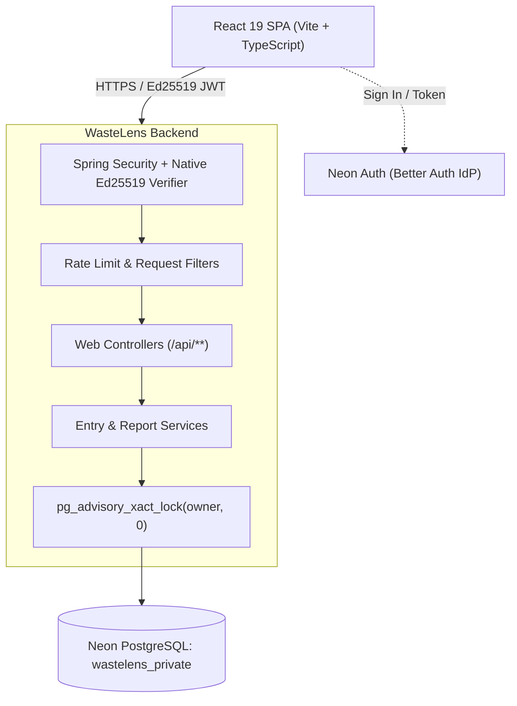

<div align="center">

# WasteLens

**Track kitchen waste. Surface trends. Prevent overproduction.**

Food waste tracking for commercial and institutional kitchens with atomic logging, idempotent replay, weekly trend analytics, and tenant isolation.

[Open WasteLens](https://veshwik-wastelens.embarko.app/) · [Run locally](#run-locally) · [Backend Code](code/backend) · [Frontend Code](code/frontend) · [Release Verification](documents/release-verification.md)

[](https://github.com/VJ-veshwikjain2215/WasteLens/actions/workflows/ci.yml)
[](code/backend/pom.xml)
[](code/backend/pom.xml)
[](code/frontend/package.json)
[](code/frontend/package.json)
[](code/backend/src/main/resources/db/migration)

</div>

---

## What WasteLens Does

Commercial kitchens generate waste across preparation, service, and storage. WasteLens provides high-integrity logging and actionable analytics to identify cost drivers and cut waste:

- **Atomic Waste Logging & Idempotency** — Prevents duplicate records during network timeouts or double submissions using client UUIDs and transaction-level PostgreSQL advisory locks (`pg_advisory_xact_lock`).
- **Weekly Analytics & Trends** — Real-time aggregation of weekly total grams, item counts, ongoing week status, and deterministic top waste categories.
- **Period Comparisons** — Direct week-over-week comparison across arbitrary Mondays with signed differences and exact half-up percentage change calculations.
- **Strict Multi-Tenant Isolation** — Enforced through Postgres Row Level Security (RLS) in an isolated `wastelens_private` schema, verified against cross-tenant queries.
- **Bounded JSON Export** — Streams tenant data with strict sorting (`entryDate ASC, id ASC`), limited payload memory bounds (8 MiB), and concurrent operation semaphores.
- **High-Assurance Security** — Native Java Ed25519 cryptographic token validation for Neon Auth (Managed Better Auth), strict Content Security Policy, rate-limiting, and 401 challenges.

---

## System Architecture



---

## Built With

| Layer | Technology |
| :--- | :--- |
| **Backend** | Java 21, Spring Boot 3.4.0, Spring Web, Spring JDBC, Spring Security Resource Server |
| **Frontend** | React 19, TypeScript, Vite, responsive vanilla CSS |
| **Cryptography** | Native Java 21 SunEC engine (`Signature.getInstance("Ed25519")`), Nimbus JOSE JWT |
| **Database** | Neon PostgreSQL with Row Level Security (RLS) and custom `wastelens_private` schema |
| **Authentication** | Neon Auth (Managed Better Auth) with Ed25519 asymmetric key pair signing |
| **Deployment** | Embarko application platform (`railpack.json` Java provider) |
| **CI / CD** | GitHub Actions (automated frontend typecheck, backend unit, and Postgres container tests) |

---

## Demo Accounts

The hosted application includes 1-click credential filling on the login view:

| Account | Email | Password | Role |
| :--- | :--- | :--- | :--- |
| **Demo Account A** | `account-a@wastelens.demo` | `WasteLensDemo2026!` | Primary Tenant |
| **Demo Account B** | `account-b@wastelens.demo` | `WasteLensDemo2026!` | Isolated Secondary Tenant |

---

## Run Locally

### Prerequisites
- **Java 21+** (`java -version`)
- **Node.js 24+** & **npm 11+**
- **Docker** or a local **PostgreSQL 16** instance

### 1. Clone the repository
```bash
git clone https://github.com/VJ-veshwikjain2215/WasteLens.git
cd WasteLens
```

### 2. Configure environment
Copy the sample environment file in `code/`:
```bash
cp code/.env.example code/.env.local
```

### 3. Start local database
```bash
docker compose -f code/compose.yaml up -d
```
Run the initial migration:
```bash
psql -h localhost -U wastelens_app -d wastelens -f code/backend/src/main/resources/db/migration/V1__init_schema.sql
```

### 4. Build frontend & backend
```bash
# Build frontend static assets into backend resources
cd code/frontend
npm ci
npm run build

# Run backend
cd ../backend
./mvnw spring-boot:run
```

Access the application at `http://localhost:8080`.

---

## Verification & Tests

```bash
# Frontend component tests (Vitest)
cd code/frontend
npm test -- --run

# Backend unit & integration tests (JUnit 5 + Spring Boot Test)
cd code/backend
./mvnw test

# Full live production verification
python code/ops/verify-live.py
```

---

## License

This project is licensed under the MIT License - see the [LICENSE](LICENSE) file for details.
